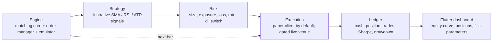

# Architecture

`oculus-lite` is a small, deterministic event-driven trading-system skeleton.
It demonstrates the plumbing of a real execution stack — matching, order
lifecycle, risk gating, paper/live execution, ledger and metrics — while
shipping no proprietary signal or tuned parameter.

## Pipeline

The order above is deliberate: the **engine** supplies deterministic primitives
and market events, the **strategy** turns events into an intended direction,
**risk** decides whether that intention may become an order, **execution** turns
the order into fills, and the **ledger** turns fills into equity and metrics.
The dashboard is a read-only consumer of the ledger.

## One bar, step by step

1. **Engine.** The bar is timestamped and delivered to the paper client. Orders
   submitted on the previous bar rest in price/time-priority books (or in the
   stop/emulator pending list) and are matched at this bar's open.
2. **Strategy.** Indicators are updated with the bar's close/high/low. The
   illustrative signal is an SMA crossover filtered by RSI and an ATR volatility
   floor. It is intentionally ordinary: it exists to exercise the plumbing.
3. **Risk.** A `RiskGuard` checks order quantity, absolute exposure, order rate,
   daily loss, drawdown and consecutive losses. A kill switch blocks every
   submission. A rejected order produces a `RiskHalt` event and a cooldown.
4. **Execution.** In paper mode the `PaperClient` uses the same matching core as
   the backtester, with deterministic slippage. Live mode is only reachable with
   `--live` plus credentials and an operator-supplied gateway URL; fills on that
   path are venue-reported and are never simulated locally.
5. **Ledger.** Each fill updates cash and position, realises PnL on reductions,
   and records a trade. End-of-bar equity is marked to the bar close. Metrics:
   annualised Sharpe, peak-to-trough drawdown, win rate, expectancy per trade and
   turnover (traded notional divided by average equity).

## Determinism

- Prices are quantised to 1/10,000 and used as `u64` book keys; no float equality
  is used for ordering.
- Books use `BTreeMap` and FIFO queues; events and reports are emitted in sorted
  order, never by iterating a hash map.
- Orders created during a bar can only fill at the **next** bar's open, so no
  calculation reads a future price.
- Two runs with the same config and the same CSV produce byte-identical reports;
  this is asserted in `tests/determinism.rs`.

## Crate layout

| Crate | Responsibility |
|---|---|
| `rust/execution` | `matching_core`, `order_manager`, `order_emulator`, `protection`, `trailing`, `reconciliation`, `client`, models, bench |
| `rust/indicators` | Streaming SMA, EMA, RSI, ATR, MACD and VWAP with bounded memory |
| `rust/oculus-config-rs` | 50-field validated config schema and YAML-subset parser |
| `backtester` | CLI and library for the deterministic replay and metrics |
| `trader` | Paper-first trader and the explicitly gated live venue |
| `tests` | Integration tests for determinism, paper fills and risk limits |

## Intentionally absent

No genetic algorithm, evolution, genome/champion registry, regime detection,
auto-optimisation, FTROM weights, alpha/courtroom/persona logic, private
endpoints, exchange keys or real market data. Those parts belong to the private
engine and are not represented here, even in abbreviated form.
